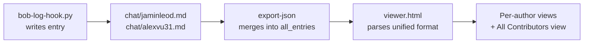

---
**bob-response** | 2026-11-24T17:05:47Z | author: `jaminleod` | session: `8606d5cc441ea48f44da5e843fb64605`

Sub-Tasks 2 and 3 are both done. Here's a summary of everything added in this session:

---

**Sub-Task 3 — Bob Hook Configuration ✅**

| File | What it does |
|---|---|
| [`bob-log-hook.py`](bob-log-hook.py) | Reads Bob's JSON stdin, formats a Markdown entry with timestamp/author/session, calls `bob_log.py append chat/$USER.md` |
| [`.bob/settings.json`](.bob/settings.json) | Wires `Stop` and `UserPromptSubmit` to the hook wrapper |

**Also added to Sub-Task 2:**

| Addition | What it does |
|---|---|
| `bob-log export-json [dest]` in [`bob_log.py`](bob_log.py) | Walks the entire shadow branch with `git ls-tree -r`, reads every blob, dumps `{ "files": { "<path>": "<content>" } }` JSON — the format Alex needs for the viewer |

**Verified:**
- `Stop` correctly appends `bob-response` entries to `chat/jaminleod.md`
- `UserPromptSubmit` correctly appends `user-prompt` entries — **stdout is empty** (clean model context)
- Both hooks exit 0 (fail-open — never block Bob)

Ready for you to commit and tag. After that, Sub-Task 4 is on Alex, and Sub-Task 5 (tests + README) is next for you.

---
**user-prompt** | 2026-11-24T17:06:15Z | author: `jaminleod` | session: `8606d5cc441ea48f44da5e843fb64605`

Give me commit and tag message

---
**bob-response** | 2026-11-24T17:06:18Z | author: `jaminleod` | session: `8606d5cc441ea48f44da5e843fb64605`

**Commit message:**
```
feat: add hook wrapper and export-json for Sub-Tasks 3 & 4

- bob-log-hook.py: reads Bob JSON stdin, appends timestamped Markdown
  entries to chat/$USER.md on the shadow branch for Stop and
  UserPromptSubmit events; stdout stays empty on UserPromptSubmit
- .bob/settings.json: wires Stop and UserPromptSubmit to the hook wrapper
- bob_log.py: add export-json subcommand — dumps all shadow-branch files
  as { "files": { "<path>": "<content>" } } JSON for the HTML viewer

Closes Sub-Task 3. Provides the export format Alex needs for Sub-Task 4.
```

**Tag:**
```
git tag -a v0.3-sub-task-3 -m "Sub-Task 3 complete: hook wrapper + settings + export-json"
```

---
**user-prompt** | 2026-11-24T17:08:36Z | author: `jaminleod` | session: `8606d5cc441ea48f44da5e843fb64605`

Anything else for us to do?

---
**bob-response** | 2026-11-24T17:08:40Z | author: `jaminleod` | session: `8606d5cc441ea48f44da5e843fb64605`

Looking at the plan, your side (jaminleod) is fully done:

- ✅ Sub-Task 1 — Shadow branch init
- ✅ Sub-Task 2 — `bob_log.py` CLI
- ✅ Sub-Task 3 — Hook config

What's left:

| Sub-Task | Owner | Status |
|---|---|---|
| 4 — HTML Viewer | alexvu31 | Pending — he can start now, you've given him the JSON format |
| 5 — Tests & README | Both | Pending — you can start `test_bob_log.py` and the README independently of Alex |
| 6 — PDF Submission | Both | Pending — blocked until 4 & 5 are done |

**The only thing worth doing now on your side is Sub-Task 5** — the test suite and README. Neither depends on Alex finishing the viewer. Want me to start on that?

---
**user-prompt** | 2026-11-24T18:15:02Z | author: `jaminleod` | session: `8606d5cc441ea48f44da5e843fb64605`

Okay Alex finished his portion but we're going to go over it; there's a couple things I'd like to change. Firstly, the chats don't need to be in MD... We want to get the output of the AI chats and make what looks to be a cohesive unit of data. And we also want a chat that is an accumulation of every committers work (all chats combined) so it you can see when things were changing.

Also the card bodies for the chat look ugly and do not have styling, they are in plaintext as so:
**Timestamp:** 2026-11-24T14:10:22Z
**Author:** alexvu31
**Type:** user-prompt
**Session:** def-001

Execute sub-task 4 and sub-task 5

**Timestamp:** 2026-11-24T14:11:05Z
**Author:** alexvu31
**Type:** bob-response
**Session:** def-001

Built viewer.html - single-file HTML timeline viewer with file picker, drag-and-drop, author colour badges, event-type tags, and print-friendly CSS. Also wrote test_bob_log.py and README.md.

And it doesn't show bob's follow up questions, nor what he changed. Maybe we should have it mark to a commit (harder) or some form of modifying to show.

The 'md' files for the AI bots show up as they should I believe, but a history (since we have git already) of where changes were made and by which committer (and their AI agent) would be nice.

How do you feel about this? We add more to the plan to get this looking like that?

---
**bob-response** | 2026-11-24T18:17:19Z | author: `jaminleod` | session: `8606d5cc441ea48f44da5e843fb64605`

Good. I have enough to scope this cleanly. Here's what the plan looks like:

---



---

**Three changes, clearly separated:**

**1. Align the entry format** — the hook and the viewer's parser need to agree on one format. The viewer's `## Entry-NNN` format is the right one because it's parseable and readable as raw Markdown. The hook currently writes a different ad-hoc format. We fix the hook to write the `## Entry-NNN` format.

**2. Render card bodies as Markdown** — in the viewer, change `escH(e.body)` to `renderMarkdown(e.body)` in `renderTimeline()`, and swap `white-space: pre-wrap` on `.card-body` for `md-view` class styling.

**3. "All Contributors" view** — synthesised virtually in the viewer at load time by merging entries from all `chat/` files, sorting by timestamp. A new sidebar entry "💬 All Contributors" appears at the top of the chat group. No hook changes, no data duplication.

Does this match what you had in mind, or do you want to adjust anything before I write this up as a plan file and implement it?
